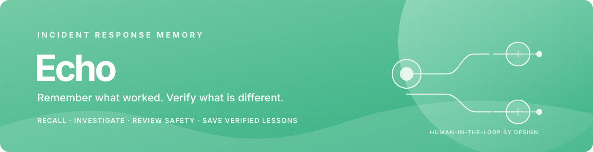
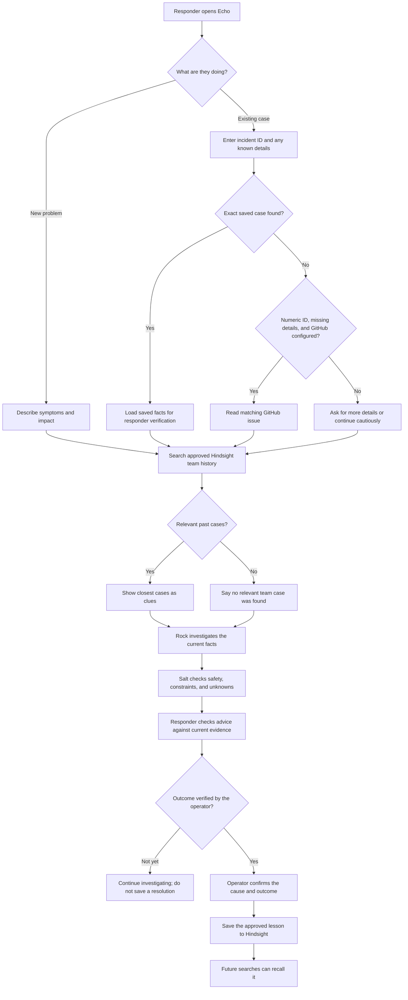
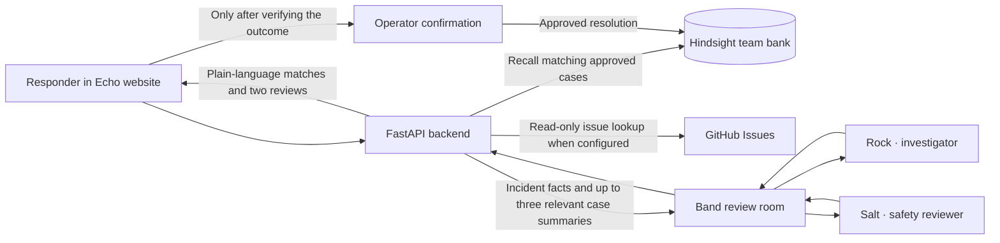

<div align="center">
  
  <br><br>
  
  
  
  
  
</div>

<br>

<p align="center"><strong>Keep the lesson. Check the match. Help the next person respond.</strong></p>

Echo is an incident-response memory copilot. It searches operator-approved incident history, asks an investigator and an independent safety reviewer to assess the current report, and helps the team save a verified outcome for next time.

> **Human stays in control:** Echo offers evidence and safe checks. It does not access production systems or apply fixes. A past action is a clue to verify, never permission to repeat it.

## The idea

```json
{
  "name": "Echo",
  "mission": "Make a team's incident experience useful to the next responder.",
  "input": "A new incident report, with whatever details the responder knows",
  "memory": "Separate Hindsight banks for fictional examples and approved team history",
  "review": "Rock investigates; Salt independently checks safety and constraints",
  "learning_rule": "Save only after an operator confirms the outcome"
}
```

## How an incident moves through Echo

The responder can begin with a new problem or an existing incident ID. Echo uses the details available; the ID alone does not reveal live system status.



### What the reviews contribute

| Part | What it does | What it does not do |
|---|---|---|
| **Hindsight memory** | Finds relevant, operator-approved past cases across different wording and incident IDs. | Treat a similar incident as proof of the same cause. |
| **Rock · Investigation** | Separates known facts from possibilities and suggests a few safe checks. | Claim it inspected logs or systems unless the supplied evidence says so. |
| **Salt · Safety review** | Checks advice against constraints, marks unknowns, and flags steps needing approval. | Authorize or perform production changes. |
| **Operator confirmation** | Saves the verified cause, resolution, and prevention lesson for future recall. | Save a proposed fix as a confirmed outcome. |

## How the pieces connect



The public walkthrough's fictional examples live in a separate Hindsight bank from the live team's approved history. Hindsight and Band credentials are read by the backend; the browser never receives the API keys. Incident details and relevant saved summaries are sent to the connected Band agents for a requested review.

## What you can try

- **Walk through the story:** the home page's **See the workflow** link uses fictional examples to explain recall, review, and learning.
- **Try the public demo:** edit a sample incident, see relevant sample history, and read a cautious response brief.
- **Investigate with the live workspace:** start a new case or look up an existing one; leave unknown fields blank and add details as they become available.
- **Review memory:** search confirmed team outcomes or add one sanitized, approved past case.
- **Save a lesson:** record a cause, resolution, and prevention step only after the team verifies them.

## Run locally

### 1. Configure Hindsight

Create the local settings file and add your Hindsight Cloud key:

```sh
cd incident-response-copilot
cp .env.example .env
# Edit .env and set HINDSIGHT_API_KEY. Keep this file private.
```

The `.env.example` includes the Echo Rock and Salt agent IDs. For live Band reviews, also set `BAND_USER_API_KEY` in `.env` and configure `../rock-salt-agents/agent_config.yaml` with the agents' private credentials. The Codex CLI must be installed and authenticated. On macOS, Echo checks the standard ChatGPT app location; set `CODEX_CLI_PATH` if yours is elsewhere.

### 2. Install and prepare the separate memory banks

```sh
python3 -m venv .venv
.venv/bin/python -m pip install -e .
.venv/bin/python setup_memory.py
.venv/bin/python setup_live_memory.py
```

The public demo bank contains fictional examples. The team bank begins empty and should contain only information your team approved for this use.

### 3. Start Echo

```sh
.venv/bin/python web_api.py
```

Open [http://127.0.0.1:8000](http://127.0.0.1:8000). When Band is configured, the server starts Rock and Salt automatically. If port 8000 is already in use, start on another port:

```sh
.venv/bin/python -m uvicorn web_api:app --host 127.0.0.1 --port 8001
```

For the full setup, environment variables, and workflow page list, see [`incident-response-copilot/README.md`](incident-response-copilot/README.md).

## Project structure

| Folder | Purpose |
|---|---|
| [`outputs/halden-port-ops/`](outputs/halden-port-ops/) | Echo home page, fictional walkthrough, dashboard, live workspace, memory, review, and outcomes pages. |
| [`incident-response-copilot/`](incident-response-copilot/) | FastAPI backend, Hindsight integration, Band bridge, and setup instructions. |
| [`rock-salt-agents/`](rock-salt-agents/) | Read-only Band workers for Rock and Salt; local credentials are excluded from Git. |
| [`docs/`](docs/) | README banner artwork. The editable Mermaid flowcharts live in this README. |

## Evaluation story

- **Innovation:** connects a new report to useful past lessons, even when the wording or item differs.
- **Use of Hindsight:** memory is central to recall and improves as operators add verified outcomes.
- **Technical implementation:** server-side API keys, separate demo and team banks, read-only issue lookup, duplicate-reference checks, and live Rock/Salt review.
- **User experience:** new and existing case paths, optional details, plain-language findings, and separate safety review.
- **Real-world impact:** helps responders find prior team experience and choose safer checks during recurring incidents.

## Current limits

Echo is a hackathon prototype. The dashboard is not an authenticated sign-in system. GitHub issue lookup reads issue text only; Echo does not connect to monitoring, logs, deployments, or production services, and it cannot execute remediation. Add those integrations only with a team's security and access controls in place.

<div align="center">
  <sub>Built for the moment someone says: “Didn't we solve this before?”</sub>
</div>
